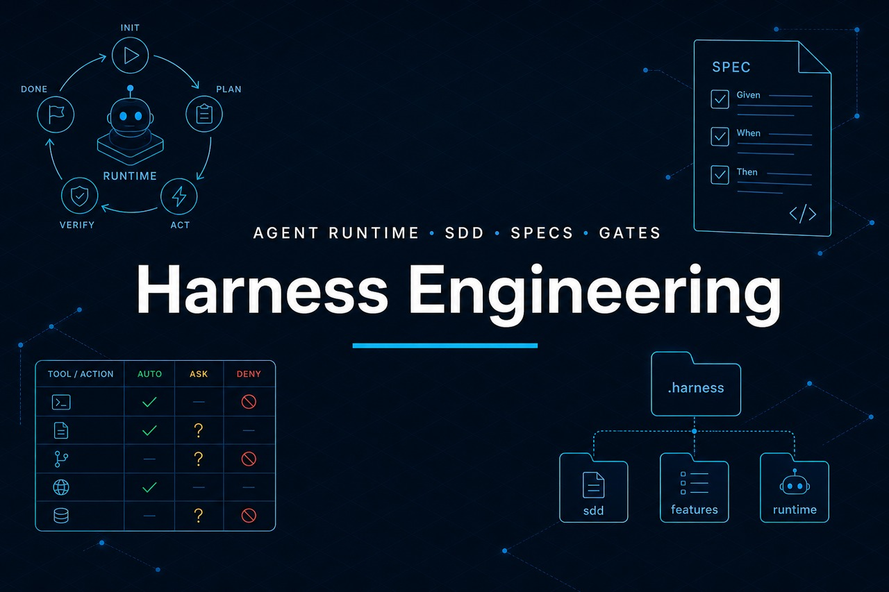

<p align="center">
  
</p>

# AI Engineering Harness

A **template** for AI-assisted engineering that any repository can adopt, whatever the company, product, stack or cloud.

This repository **is not an application**. It is the **base** that other projects install. The target project gets only the operational layer `.ai-harness/` (plus optional adapters). The product code stays in your repository.

**Tool-agnostic:** the harness is plain Markdown plus portable scripts (bash, Python 3, git). Any AI agent, IDE or person can follow it. Optional adapters only point a specific tool at `.ai-harness/agents.md`.

## What the target project gets

```text
.ai-harness/
├── agents.md        Mandatory entrypoint for any agent
├── Knowledge/       architecture · domain · standards · ADR · stacks/ (stack packs)
├── Specification/   requirements · use cases · acceptance (per feature)
├── Agents/          architect · developer · reviewer · tester · project context
├── Workflows/       feature · bug · refactoring · migration · infra
├── Tools/           build · test · git · validation · infra · bin/check-harness.py
├── Governance/      security · quality · architecture · cost · permissions
└── Runtime/         loop · runs · sandbox
```

## Stack packs

The baseline rules apply to any stack. Stack packs add language/framework/platform details, and the agent reads only the active ones:

| Languages & frameworks | DevOps & cloud |
|------------------------|----------------|
| .NET · Blazor · Java/Kotlin · Android · TypeScript · Node.js · Angular · React · React Native · Vue/Nuxt · Flutter · iOS/Swift · Python · Go · Rust · PHP (Laravel/Symfony) · Ruby (Rails) | DevOps (containers, Kubernetes, Terraform/OpenTofu, CI/CD, OpenTelemetry) · AWS · Azure · GCP · OCI |

Cross-cutting packs: **database** (schema migrations) and **data** (dbt, Spark, notebooks, ML).

`fill-harness.py` detects the stack and records the active packs in `Agents/project.md`. See [template/Knowledge/stacks/readme.md](template/Knowledge/stacks/readme.md).

## Use this template in another repository

```bash
git clone <this-template-url> harness-engineering

# existing project (creates .ai-harness/ + AGENTS.md)
./harness-engineering/scripts/init-harness.sh /path/to/project MyApp

# pick adapters for the tools your team uses (default: agents-md)
./harness-engineering/scripts/init-harness.sh /path/to/project MyApp --adapters=agents-md,copilot,claude

# install and infer Knowledge/Tools/specs from the README and code
./harness-engineering/scripts/init-harness.sh /path/to/project MyApp --enrich
```

On GitHub you can mark this repository as a **Template repository** to fork the kit itself. To apply the harness to a product, use `init-harness.sh` — do not copy the whole kit into the app.

## Update a project that already uses the harness

```bash
./harness-engineering/scripts/init-harness.sh /path/to/project --update
```

Refreshes the canonical rules (Agents, Workflows, Governance, Tools, Runtime, templates, kept stack packs) and migrates legacy file names. **Preserves** filled Knowledge, features and `Agents/project.md`. Installed version: `.ai-harness/.kit-version` (current: [VERSION](./VERSION), history: [changelog.md](./changelog.md)).

## Check the rules automatically

```bash
python3 .ai-harness/Tools/bin/check-harness.py                         # harness structure
python3 .ai-harness/Tools/bin/check-harness.py --diff origin/main      # rules on your changes
python3 .ai-harness/Tools/bin/check-harness.py --coverage "**/coverage.cobertura.xml"   # >= 80% per artifact
python3 .ai-harness/Tools/bin/check-harness.py --install-hook          # git pre-commit
```

It runs the same way in a terminal, a git hook or any CI. On the diff it flags removed attributes/annotations and IaC protections, cloud secrets and sensitive files, insecure code/IaC patterns, logging problems, code without unit tests, tests outside a feature folder and test naming.

## Fill in later (optional)

```bash
python3 harness-engineering/scripts/fill-harness.py /path/to/project
python3 harness-engineering/scripts/deep-fill-harness.py /path/to/project
python3 harness-engineering/scripts/enrich-harness.py /path/to/project
```

## Relationship with the SDLC

```text
Company governance                 Harness (execution in the repo)
─────────────────────────          ─────────────────────────
Phases and quality gates           Workflows + Runtime gates
AI usage policy                    Governance/permissions.md
DoR / DoD                          Specification acceptance + DONE
Squad playbook                     agents.md + Agents/*
Charter / compliance               Knowledge + Governance
```

Map: [docs/sdlc-mapping.md](docs/sdlc-mapping.md).

## Layout of this kit

```text
harness-engineering/          ← you are here (the kit)
├── VERSION · changelog.md
├── template/                 → copied to <project>/.ai-harness/
├── adapters/                 optional tool pointers, generated from adapters/source/
├── scripts/                  init-harness.sh · fill/deep-fill/enrich · build-adapters.py
├── tests/run.sh              kit self-tests
├── evals/                    rule-adherence scenarios for any agent
└── docs/
```

Guide: [docs/adoption-guide.md](docs/adoption-guide.md) · Adapters: [docs/ide-adapters.md](docs/ide-adapters.md) · Rules: [docs/rules-baseline.md](docs/rules-baseline.md) · Evals: [evals/readme.md](evals/readme.md).

## Principles (for every project that adopts the kit)

- Spec before code — no acceptance → `BLOCKED`.
- **Code and tests always by feature**; new features mirror the existing structure.
- **Rich domain always**; handlers and services orchestrate.
- **Unit tests in every change; ≥ 80% line coverage on every testable artifact.**
- **Security baseline (S1–S12) and rich logging (L1–L8) verified on every implementation.**
- Business-rule changes need human confirmation.
- **OSS first** — proprietary cloud services only with an ADR.
- AI produces; humans approve whatever is `ask`.
- Knowledge + Governance > model preference.
- Agnostic of tool, IDE, stack and cloud.

## Development of the kit

```bash
python3 scripts/build-adapters.py   # regenerate adapters after editing adapters/source/harness.md
bash tests/run.sh                   # must end with 0 failed
```

## License

[LICENSE](LICENSE) (MIT). Use, copy and adapt in any repository.
